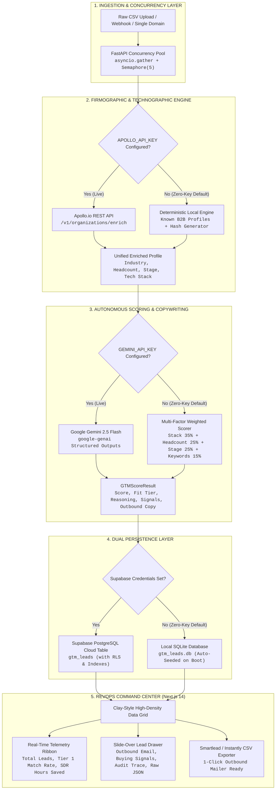

# Automated GTM Lead Enrichment, ICP Scoring & Outbound Sequence Engine

[](https://fastapi.tiangolo.com)
[](https://nextjs.org)
[](https://www.typescriptlang.org)
[](https://tailwindcss.com)
[](https://ai.google.dev)
[](https://apollo.io)
[](https://opensource.org/licenses/MIT)

A production-grade, full-stack Go-To-Market (GTM) Engineering pipeline and RevOps command dashboard. The system ingests raw B2B target company domains, enriches firmographic and technographic data via **Apollo.io**, executes strict algorithmic Ideal Customer Profile (ICP) fit scoring and personalized outbound sequence copywriting via **Google Gemini Structured Outputs**, persists records with dual storage (**Supabase PostgreSQL** or local **SQLite**), and renders a Clay.com / Linear-inspired high-density interface.

> **Target Repository:** `https://github.com/Codingbysid/GTM-`  
> **Proof of Work:** Built for technical founders, CTOs, and RevOps leaders seeking verified pipeline automation.

---

## ⚡ System Architecture



---

## 🛡️ Dual-Mode Architecture: Zero-Key by Default

This repository ships with a **Zero-Key Deterministic Simulation Engine enabled by default**. Anyone who clones the repo can run the entire pipeline out-of-the-box without creating accounts or loading API keys:

| Engine | Zero-Key Mode (Default) | Live Production Mode (`.env`) |
|---|---|---|
| **Enrichment** | Deterministic mock engine with realistic presets for 10 benchmark companies (`linear.app`, `supabase.com`, `modal.com`, etc.) + deterministic hashing for arbitrary domains with simulated network delay (`0.25s`). | Live `https://api.apollo.io/v1/organizations/enrich` via `httpx.AsyncClient`. |
| **ICP Scorer & Copywriter** | Weighted multi-factor algorithmic engine scoring tech stack (0–35 pts), headcount sweet spot (0–25 pts), funding stage (0–25 pts), and custom criteria keywords (0–15 pts). | Google Gemini 2.5 Flash via official `google-genai` SDK with strict JSON Schema (`response_schema=GTMScoreResult`). |
| **Persistence** | Zero-config local SQLite (`gtm_leads.db`), **auto-seeded on startup** with 10 accounts if empty. | Supabase PostgreSQL with automated upserts, connection pooling, and row-level security. |

---

## 🚀 Key Engineering Highlights

1. **Zero-Key Verifiability**: Employers and reviewers can run `uvicorn` and `npm run dev` and immediately see a populated, interactive RevOps dashboard without setting environment secrets.
2. **Strict Pydantic Contract**: Guarantees typed data contracts (`RawLead`, `EnrichedCompany`, `GTMScoreResult`, `PipelineTraceStep`, `LeadRecord`) across the entire stack.
3. **Audit Execution Trace**: Measures and attaches execution latency for every pipeline step:
   - `[STEP 1: INGEST]` Domain and contact role validation
   - `[STEP 2: ENRICH]` Firmographic and technographic extraction
   - `[STEP 3: ICP_SCORE]` Weighted algorithmic fit scoring
   - `[STEP 4: SEQUENCE_GEN]` Hyper-personalized variable-injected cold email synthesis
   - `[STEP 5: SYNC]` SQLite / Supabase database upsert
4. **Controlled Concurrency**: CSV uploads process concurrently using `asyncio.gather` bounded by `asyncio.Semaphore(5)` to prevent upstream API saturation.
5. **Dynamic Outbound Personalization**: Variables (`{{company_name}}`, `{{top_tech_stack}}`, `{{funding_stage}}`, `{{contact_role}}`) are dynamically woven into high-converting subject lines, icebreakers, and sequence bodies.
6. **Clay.com / Linear Aesthetic**: Dark slate/zinc theme (`#09090B`, 1px borders `#27272A`, monospace font badges) with collapsible slide-over inspector drawer.

---

## 📁 Repository Structure

```text
GTM-/
├── backend/
│   ├── main.py              # FastAPI app, endpoints, startup auto-seeding, CSV streaming
│   ├── models.py            # Pydantic schemas (RawLead, GTMScoreResult, PipelineTraceStep)
│   ├── services/
│   │   ├── apollo.py        # Apollo.io async client + deterministic enrichment engine
│   │   ├── gemini_scorer.py # Gemini 2.5 structured output scorer + multi-factor algorithmic engine
│   │   └── database.py      # Dual persistence layer (SQLite + Supabase) & telemetry math
│   ├── sample_leads.csv     # 10 realistic B2B SaaS benchmark domains
│   ├── supabase_schema.sql  # Supabase DDL schema with indexes and RLS
│   ├── requirements.txt     # Python backend dependencies
│   └── .env.example         # Documented backend environment configuration
├── frontend/
│   ├── src/app/             # Next.js 14 App Router (page.tsx, layout.tsx, globals.css)
│   ├── src/components/      # TelemetryRibbon, PipelineControlBar, LeadsTable, LeadDrawer, Modals
│   ├── src/lib/             # Typed API client (api.ts) & UI formatting utilities (utils.ts)
│   ├── src/types/           # TypeScript interfaces matching backend models
│   ├── tailwind.config.ts   # Dark zinc theme tokens & monospace typography
│   └── .env.local.example   # Frontend local environment template
└── README.md                # Architecture, documentation, and portfolio guide
```

---

## 🛠️ Quickstart (60 Seconds to Live Demo)

### 1. Start Backend (FastAPI)
```bash
cd backend
python3 -m venv venv
source venv/bin/activate
pip install -r requirements.txt
uvicorn main:app --reload --host 127.0.0.1 --port 8000
```
*Note: On first startup, the backend automatically initializes `gtm_leads.db` and auto-seeds all 10 benchmark leads from `sample_leads.csv`.*

Swagger API documentation is live at: `http://localhost:8000/docs`

### 2. Start Frontend (Next.js 14)
```bash
cd frontend
npm install
npm run dev -- -p 3000
```
Open `http://localhost:3000` (or `http://localhost:3001` if port 3000 is occupied) in your browser.

---

## ⚡ Verifying the Pipeline (Live Workflow)

1. **Auto-Populated Dashboard**: Notice all 10 benchmark accounts (Linear, Stripe, Supabase, Vercel, Modal, LangChain, Retool, PostHog, Scale AI, Deel) already enriched and scored with telemetry calculated.
2. **Inspect Lead Drawer**: Click on any company row (e.g. **Linear** or **Modal**) to open the right-hand slide-over:
   - **Outbound Sequence**: View the tailored cold email and test the 1-click **"Copy Cold Email"** button.
   - **Scoring & Signals**: Review the fit score breakdown, 2-sentence rationale, and detected buying signals.
   - **Pipeline Trace**: View the step-by-step latency audit log from Ingestion (`0.01s`) to Sync (`0.02s`).
   - **Raw JSON**: Inspect the complete combined Apollo + Gemini payload with 1-click copy.
3. **Single Domain Live Test**: Click **"Single Domain Live Test"**, enter `ramp.com` or `resend.com`, and watch the pipeline enrich, score, and persist the lead in real time.
4. **Dynamic ICP Customization**: Click **"Configure ICP Criteria"**, modify the target criteria prompt, and observe how scores adjust for subsequent accounts.
5. **Outbound Export**: Click **"Export to Outbound CSV ↗"** to download a CSV ready for immediate upload to Smartlead, Instantly, or Apollo.

---

## 📡 API Reference

| Method | Endpoint | Description |
|---|---|---|
| `GET` | `/api/health` | Service health and active provider status (Live vs. Zero-Key) |
| `GET` | `/api/telemetry` | Real-time KPI metrics (`total_leads`, `tier_1_match_rate`, `sdr_hours_saved`) |
| `GET` | `/api/leads` | Filterable lead queries sorted by score DESC (`fit_tier`, `min_score`, `search`) |
| `POST` | `/api/leads/run-sample` | Triggers the 10-lead benchmark batch with concurrency limit = 5 |
| `POST` | `/api/leads/enrich-single` | Real-time single domain enrichment, scoring, and storage |
| `POST` | `/api/leads/upload-csv` | Asynchronous batch upload with multipart form handling |
| `GET` | `/api/leads/export-csv` | Streams Smartlead/Instantly-formatted outbound CSV |
| `DELETE` | `/api/leads/reset` | Purges database and re-seeds fresh benchmark accounts |

---

## 🔌 Switching to Live Production Keys (Optional)

To enable live Apollo and Gemini API calls, create `backend/.env`:
```env
APOLLO_API_KEY=your_live_apollo_key
GEMINI_API_KEY=your_live_gemini_key
GEMINI_MODEL=gemini-2.5-flash
SUPABASE_URL=https://your-project.supabase.co
SUPABASE_SERVICE_KEY=your_service_role_key
```
The application will automatically detect the presence of keys and switch provider badges from `Zero-Key` to `Live API`.

---

## 👤 Author & Portfolio

- **Engineer:** Siddharth Gupta
- **GitHub:** [@Codingbysid](https://github.com/Codingbysid)
- **Repository:** [https://github.com/Codingbysid/GTM-](https://github.com/Codingbysid/GTM-)
- **License:** MIT
